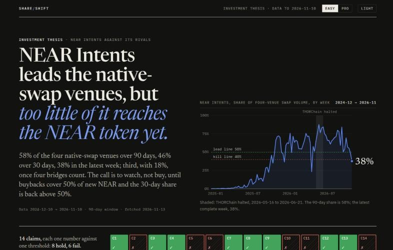

# Share Shift

An investment thesis on NEAR that tests NEAR Intents against its competitors,
with every number rebuilt from public data by one command.

[](https://github.com/n0ctr1/share-shift/actions/workflows/reproduce.yml)

Built at NEAR HACKATHON, track `thesis` (Investment Thesis). The badge is a GitHub Actions run on every push: tests,
the seal check, `python build.py --offline`, then `git diff --exit-code`, so it
is green only if the committed files are exactly what the snapshot rebuilds.

[](https://n0ctr1.github.io/share-shift/)

- Live dashboard: https://n0ctr1.github.io/share-shift/ (Easy shows the short version;
  Pro adds sources, data tables and the full evidence)
- The thesis, about two pages: [`THESIS.md`](THESIS.md)
- Method, every check and every limit: [`METHODS.md`](METHODS.md)
- Every rerun, including the primary-source checks: [`REPRODUCE.md`](REPRODUCE.md)

## The 90-second path

Needs Python 3.9 or newer; nothing to install, no key.

```
git clone https://github.com/n0ctr1/share-shift && cd share-shift
python3 -m unittest discover -s tests   # Ran 39 tests ... OK
python3 build.py --offline && git status --short   # 14 verdicts, then nothing: byte for byte
```

Then open https://n0ctr1.github.io/share-shift/, move the sliders under
"Run it yourself", and read [`THESIS.md`](THESIS.md). Every number in both
comes from `data/derived/metrics.json`; the function behind each chart is named
under it.

## The thesis in one screen

**The call: WATCH, not buy.** NEAR Intents is first of four native-swap venues
(58% of volume over 90 days, 55–60% however it is counted) but third of eight
once four large bridges count (18%, so claim C11 is refuted). Its lead is
slipping: 46% over 30 days, 38% in the latest week, when THORChain led again.

The NEAR token sees too little of it. Buybacks took 13% of the NEAR newly issued
in the window, and those buybacks are real purchases: 99.6% of the NEAR the
buyback wallet received from `intents.near` was the output of a swap into NEAR
(`python3 -m pipeline.bq buyback`).

NEAR's price is not paying for Intents. Valued as a perpetuity (13.5% discount,
7.5% growth), the cash Intents sends NEAR is worth $0.26 a token, 7% of the
$3.50 price (4–22% across the assumptions; 21% in the bull case), and would
need 13× today's level to justify the price alone. New NEAR costs holders $114M
a year against $14M of buybacks. So the case for NEAR on Intents is an option on
its cut rising, not a mispricing.

The call turns to ACCUMULATE when buybacks cover half of new NEAR and the 30-day
share is back above 50%, and to AVOID if the 90-day share falls below 40% or the
share of fees reaching NEAR stops rising. That rule is `CALL` in
`pipeline/config.py`, sealed on 2026-11-12 with three predictions due
2026-12-10; the build computes the call from the data, so a re-run can change it.

Why the market is four swap venues: they, like Intents, turn one native asset
into another across chains, while bridges mostly move the same asset; when
THORChain halted, only swap venues behaved as its substitutes
(`metrics.market_test()`). Both readings are reported.

## What does not rest on trust

- **Intents volume** is rebuilt from every log line `intents.near` wrote, every
  day of the window (NEAR's public BigQuery dataset): 60%, or 55% on the
  strictest reading (`metrics.shares_onchain()`).
- **Buybacks** are traced on chain to the swaps that bought them
  (`metrics.buyback_provenance()`).
- **The market definition** is tested on the THORChain halt
  (`metrics.market_test()`).
- **The TEE run** that recomputed the headline is checked down to Intel's root
  CA (`pipeline/tdx.py`).
- **The thresholds, the call's rule and the predictions** are sealed in three
  seals, timestamped on Bitcoin; two are written on NEAR mainnet. P4 and P5,
  due 2026-11-12, were both MET.
- **The forward view and the valuation** are models anyone can change:
  `SCENARIOS` and `VALUATION` in `pipeline/config.py`, recomputed by the build,
  and the same arithmetic in the browser, checked against Python by
  `tests/test_model.py`.
- **Confidential Intents** are measured, not ignored: 96% of the last week's
  on-chain Intents volume shows only as money through 1Click routers, with no
  public fill. That is a limit, stated in the thesis.

## What it is

| File | Role |
| --- | --- |
| `THESIS.md` | The short thesis: the call, the valuation, the risks, 14 claims, the predictions |
| `METHODS.md` | Everything behind it: every test, table, primary-source check and limit |
| `docs/index.html` | The dashboard: hand-drawn charts, each with its query; Easy and Pro modes |
| `build.py` | One command that fetches the data and regenerates all three |
| `pipeline/` | `config.py` (assumptions and seals), `fetch.py`, `metrics.py` (all arithmetic), `narrative.py` (every sentence with a figure), primary-source checks (`bq.py`, `onchain.py`, `tdx.py`, ...) |
| `REPRODUCE.md` | Every optional rerun, the TEE and seal checks, data sources |

## Why "Share Shift"

The share did shift: NEAR Intents' share of native cross-chain swap volume rose
from 40% to 58% in a year (C1). The name does not claim that the shift drove
Intents' growth. That is tested separately and fails: C2 finds 56% of the
volume gain came from a bigger market and 44% from the share gained.

## Limits

- Which venues make up "the market" is tested once, with the THORChain halt
  (`metrics.market_test()`): Intents and Maya gained while it was down and gave
  part back when it returned; no bridge did both, and Relay, which grew most,
  kept growing after THORChain came back. One event is thin evidence, so both
  a narrow set (four swap venues) and a wide set (plus four bridges) are
  reported, and the answer differs: first in one, third in the other.
- The Explorer API covers 1Click swaps, about 30% of Intents volume in the
  window, and only swaps of $1,000 or more were fetched (about 95% of 1Click
  volume in a calibration sample).
- One 37-day halt is one event, not a law. A two-day outage in the data shows
  no effect.
- THORChain's volume and NEAR's captured revenue were checked against primary
  sources (Midgard; transfers into the revenue wallets). Intents volume was
  rebuilt from `intents.near` events on every day of the window (NEAR's public
  BigQuery dataset) and on six sampled days. Through August token_diff events
  match the reported figure; from 1 September swaps settle as transfers through
  1Click routers, and counting those (both directions, router-to-solver hedging
  left out) matches it again (median 1.04 of reported). That router rule was
  found by looking at the data; it is sealed now (third seal) and P8 tests it
  on 2026-11-13 to 2026-12-10.
- Three outside facts are cited rather than computed, all in
  `pipeline/config.py`: what the THORChain halt was, a later short suspension,
  and which distribution channels also route to rival venues (each with its
  source, in `CHANNEL_NOTES`).
- Claim thresholds were chosen after a first look at the data and are not
  pre-registered. They are sealed as they stand (second seal, 2026-11-12), so a
  later change is visible, and two short predictions (P4, P5) resolve on the two
  days after the data was seen, before the hackathon deadline; both were MET
  (44.5% share against 40%, 17.0 bps against 12 bps). The seal's
  Bitcoin timestamp came after the first of those days had ended, so only the
  second is a day that had not yet happened. The call's rule and P6 to P8 are
  in a third seal made before their window starts.

## Disclosure

- All code in this repository was written during the hackathon window. There
  is no earlier baseline.
- AI coding tools were used to speed up writing the code. The author directed
  the work and is responsible for every decision and result in this repository.
- No third-party libraries in the build: Python standard library, and plain
  HTML, CSS and JavaScript in the dashboard. The optional TDX quote check
  (`pipeline/tdx.py`) needs the `cryptography` package for ECDSA and X.509.

## License

MIT, see `LICENSE`.
